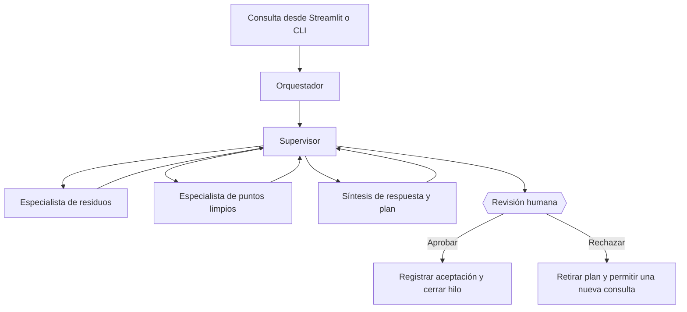

# ReciclaTIA

**¿No sabes dónde tirar algo?** Esa es la pregunta de la que parte ReciclaTIA. He desarrollado este asistente para consultar cómo gestionar residuos domésticos en **Madrid ciudad**, encontrar puntos limpios y entender la información que ofrece el Ayuntamiento sin tener que buscarla manualmente en varios documentos.

Puedes escribir una pregunta, adjuntar una foto de un objeto o buscar puntos limpios a partir de unas coordenadas. ReciclaTIA consulta sus fuentes, prepara una respuesta y te permite **aprobar o rechazar el plan** antes de cerrar la conversación.

Es un proyecto académico de *AI Engineering*. No sustituye la información municipal ni garantiza que un centro esté abierto en el momento de la consulta.

## Qué puedes hacer

- Preguntar dónde depositar un residuo: «¿Dónde tiro una botella de plástico?».
- Consultar qué es un punto limpio fijo, móvil o de proximidad.
- Buscar puntos limpios cercanos, **si decides facilitar unas coordenadas**.
- Adjuntar una imagen JPG o PNG para que se describa el objeto; su destino se contrasta después con la documentación.
- Revisar las fuentes, los resultados geográficos y el plan propuesto.
- Rechazar el plan, aclarar tu petición y volver a consultar en el mismo hilo.

La aplicación no utiliza tu ubicación GPS automáticamente. Las distancias son **en línea recta**, no rutas a pie o en coche. Cuando se indican horarios, proceden de información documentada: estar «dentro del horario publicado» **no confirma que una instalación esté abierta de verdad**.

## Ponerlo en marcha

Necesitas **Python 3.11 o 3.12**, conexión a Internet y una clave de Gemini de [Google AI Studio](https://aistudio.google.com/apikey). Gemini es un servicio externo que puede aplicar límites de uso.

Clona este repositorio y utilízalo desde la rama `main`:

```bash
git clone https://github.com/alex-bometon/pb02-multiagente-equipo18.git
cd pb02-multiagente-equipo18
```

Prepara el entorno desde la carpeta principal del proyecto:

```bash
python -m venv .venv
source .venv/bin/activate
python -m pip install -r requirements.txt
cp .env.example .env
```

En Windows (PowerShell), la activación es `.venv\Scripts\Activate.ps1` y la copia puede hacerse con `Copy-Item .env.example .env`.

Abre `.env` y sustituye el valor de `GEMINI_API_KEY` por tu clave. **No compartas ni subas este archivo al repositorio**. El proyecto utiliza un corpus de documentos municipales incluido en `data/raw/`.

### Preparar la base de conocimiento

Las consultas usan una base vectorial de **ChromaDB**. Si todavía no existe `output/chroma_db/` y ya tienes `output/embeddings.json`, reconstruye el índice sin volver a pedir embeddings:

```bash
python main.py rag index --yes
```

Si no tienes los archivos generados, puedes preparar el corpus e indexarlo desde cero:

```bash
python main.py rag index --full --yes
```

La opción `--full` vuelve a generar embeddings con Gemini, puede tardar y consumir cuota. No hace falta repetirla para cada ejecución.

### Abrir la aplicación

```bash
python -m streamlit run app.py
```

Streamlit mostrará en la terminal la dirección local de la web, normalmente `http://localhost:8501`. Una vez abierta, basta con escribir la pregunta en el chat.

## Cómo se utiliza

La barra lateral permite iniciar otra conversación, establecer los límites de turnos, adjuntar una imagen y activar voluntariamente la entrada de coordenadas. También puedes mostrar los mapas o el diagnóstico técnico del agente.

Cuando aparece un plan, tienes dos opciones:

- **Aprobar:** aceptas la propuesta y esa conversación se cierra.
- **Rechazar:** el plan deja de estar vigente y puedes decir qué quieres cambiar sin empezar desde cero.

**Aprobar no realiza ninguna acción fuera de la aplicación:** no reserva, no recoge residuos, no envía solicitudes al Ayuntamiento y no modifica datos de servicios externos.

He preparado un [manual de uso](docs/manual_uso.md) con capturas que conviene hacer, ejemplos de consultas, explicación de cada control, errores habituales y uso desde terminal.

## También funciona desde terminal

```bash
# Consultar documentos recuperados, sin generar una respuesta
python main.py rag query "¿Dónde tiro una botella de plástico?"

# Preguntar directamente al RAG
python main.py rag ask "¿Dónde tiro una botella de plástico?"

# Ejecutar una demostración del agente
python main.py agente demo "¿Dónde van las pilas?"

# Abrir una conversación interactiva
python main.py agente interactivo
```

En el modo interactivo, `/ayuda` muestra los comandos. Puedes escribir `aprobar`, `rechazar`, `/estado`, `/traza` o `/nuevo` cuando corresponda. En una demo la aprobación es manual, salvo que indiques `--auto-aprobar` expresamente.

## Cómo está construido

La base del proyecto es un **RAG**: prepara documentos municipales, los divide en fragmentos, los representa mediante embeddings y recupera la información relevante desde ChromaDB. Sobre ese RAG he montado un **sistema multiagente en LangGraph**. El supervisor dirige la consulta al especialista de residuos, al de puntos limpios o a ambos cuando hace falta. Después se prepara una respuesta y el flujo se pausa para la revisión humana (*HITL*).



El agente puede utilizar cuatro herramientas: el **RAG documental**, una **API municipal de puntos limpios** (con respaldo local si falla), la **hora de Madrid** y **Gemini para describir imágenes**. Las llamadas están restringidas mediante una lista de herramientas permitidas y límites aplicados desde Python.

Los datos de conversación se guardan mediante `MemorySaver` mientras se ejecuta el proceso. **No es una base de datos de usuarios ni un historial permanente**: al reiniciar el servidor se pierden esos checkpoints.

## Dónde está cada cosa

| Ruta | Contenido |
|---|---|
| `app.py` | Aplicación web Streamlit |
| `main.py` | Entrada a los modos de terminal |
| `src/rag.py` | API del RAG (`responder`) |
| `src/agent.py` | Procesamiento de turnos y aprobación humana |
| `src/graph.py` y `src/nodes.py` | Grafo y nodos multiagente |
| `src/agent_routing.py`, `src/agent_tool_loop.py` | Enrutamiento y ejecución controlada de herramientas |
| `src/agent_schedule.py`, `src/agent_resultado.py` | Interpretación de horarios y composición de resultados |
| `src/tools/` | Las cuatro herramientas del asistente |
| `data/raw/` | Documentos del corpus |
| `specs/` | Especificaciones técnicas y contratos |
| `docs/manual_uso.md` | Instrucciones paso a paso |
| `tests/` | Pruebas y evaluaciones |

## Comprobar el proyecto

```bash
python -m pytest tests/ -q --tb=short
python -m py_compile app.py
```

Los tests automatizados cubren componentes aislados. Para comprobar la experiencia completa hay que ejecutar también consultas reales, verificar la cuota de Gemini y probar tanto la aprobación como el rechazo. Las evaluaciones que llaman a servicios externos pueden consumir cuota.

## Alcance y fuentes

ReciclaTIA trabaja con datos sobre **Madrid ciudad**. No extrapola esas reglas a otros municipios, no crea rutas ni identifica materiales invisibles en una foto. Ante información insuficiente debe pedir una aclaración o reconocer sus límites, no inventar una respuesta.

Las fuentes de partida son archivos CSV y HTML municipales incluidos en `data/raw/`; la búsqueda geográfica usa el servicio [ArcGIS de puntos limpios de Madrid](https://sigma.madrid.es/hosted/rest/services/RESIDUOS/PUNTOS_LIMPIOS/MapServer/5/query). La descripción técnica de los conjuntos de datos y las cuestiones de procedencia están en [specs/09-datos-y-fuentes.md](specs/09-datos-y-fuentes.md).

El código se comparte con fines académicos. La inclusión de una licencia de software y la comprobación de las condiciones de reutilización de todas las fuentes son cuestiones que deben resolverse antes de redistribuirlo con otros fines.
