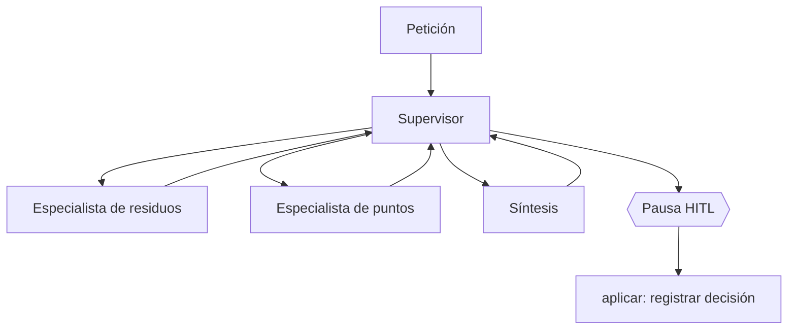

# ReciclaTIA — Informe de decisiones técnicas

## Qué he construido

ReciclaTIA combina un RAG sobre documentación municipal de residuos de Madrid con un sistema multiagente LangGraph. El RAG ya dispone de preparación de corpus, embeddings, búsqueda semántica y estructurada, generación fundamentada y abstención. La capa del agente aporta enrutamiento entre especialidades, herramientas controladas, continuidad por hilo y una revisión humana antes de cerrar cada plan.

He mantenido tres capas separadas: **conocimiento** (`src/rag.py` y módulos asociados), **orquestación** (`src/agent.py`, grafo y nodos) y **presentación** (`main.py` y `app.py`). Así la interfaz web no necesita conocer las reglas internas del agente y la CLI sigue sirviendo para depurar sin abrir el navegador.

## Diseño del grafo



El supervisor no obliga a pasar por ambos especialistas. La ruta depende de si hay que clasificar un residuo, consultar instalaciones o combinar ambas cosas. En casos sencillos evito llamadas adicionales cuando los datos necesarios ya están disponibles. En consultas compuestas, la síntesis no debería cerrarse sin atender las dos responsabilidades requeridas.

El grafo utiliza `MemorySaver` y un `thread_id` distinto para cada conversación. Es una memoria de ejecución, no una persistencia permanente en disco.

## Herramientas

| Tool | Decisión de diseño |
|---|---|
| `consultar_rag` | Mantener el RAG independiente y no duplicar embeddings, retrieval o generación dentro de LangGraph |
| `buscar_puntos_limpios_cercanos` | Utilizar datos municipales con fallback local identificado, sin confundir proximidad con ruta o apertura |
| `hora_actual` | Proporcionar una hora explícita de Madrid para comprobaciones horarias documentales |
| `describir_imagen` | Separar la percepción visual de la clasificación del residuo, que necesita evidencia del RAG |

Las herramientas se ejecutan a través de una allowlist. Además de verificar qué herramientas existen, limito qué especialista puede utilizar cada una y el número de llamadas permitido. La traza muestra qué camino se ha seguido y qué fuente ha respondido, sin incorporar credenciales.

## Qué aporta la síntesis

Además de redactar con Gemini cuando hace falta, el agente dispone de rutas deterministas. `agent_schedule.py` interpreta horarios publicados y `agent_resultado.py` integra clasificación, ubicación, modalidad y distancia cuando la evidencia es suficiente. Para preguntas sencillas puede reutilizar directamente una respuesta documentada del RAG sin introducir otra generación innecesaria.

No uso la hora actual para asegurar que un punto esté abierto. Tampoco recomiendo una instalación para un residuo solo porque esté cerca: la compatibilidad del destino necesita apoyo documental.

## HITL

El grafo se interrumpe **antes de `aplicar`**. El usuario ve el plan y decide. Con una aprobación, el sistema registra la decisión y cierra el hilo; con un rechazo, retira el plan y admite una nueva petición dentro de la misma conversación.

El nombre `aplicar` puede llevar a confusión. En esta implementación **no se ejecutan acciones externas tras aprobar**. La etapa existe para cerrar el flujo bajo decisión humana, no para enviar datos al Ayuntamiento ni realizar reservas.

### Cómo demostrar las dos ramas

Para la aceptación, ejecuto una consulta, reviso el plan y pulso **Aprobar**. Compruebo en el estado que `pendiente_hitl` pasa a falso y `done` a verdadero.

Para el rechazo, abro un hilo diferente, solicito un plan, pulso **Rechazar** y reformulo la consulta. Verifico que el plan anterior no se reutiliza como evidencia y que `done` continúa siendo falso hasta una aprobación posterior.

Son **pasos de demostración**. No se adjuntan en este documento salidas de ejecución o capturas que no hayan sido generadas realmente.

## Tres problemas que han condicionado el diseño

**1. Resultados semánticos de modalidad incorrecta.** Una búsqueda vectorial puede devolver puntos móviles cuando se pide un punto fijo de un distrito concreto. Para evitarlo, el retrieval utiliza filtros conservadores por metadatos y valida modalidad y distrito.

**2. Resúmenes que no representan el conjunto completo.** Las consultas sobre tipos de residuos podían tratar los pocos chunks recuperados como si fuesen el catálogo entero. La vía estructurada consulta relaciones y destinos del CSV de origen antes de resumirlos.

**3. Horarios y respuestas del LLM sin contexto suficiente.** La generación puede mezclar paradas o entregar citas inválidas. La solución combina identificación de la parada, validación de citas y comprobaciones horarias deterministas que nunca se equiparan a apertura física.

Estos son casos técnicos tratados por el diseño y recogidos en las pruebas de regresión. Una afirmación sobre su frecuencia o su resultado cuantitativo requiere adjuntar las ejecuciones efectivas, no extrapolar desde el diseño.

## Cómo reviso el resultado

```bash
python -m py_compile app.py
python -m pytest tests/ -q --tb=short
python main.py rag ask "¿Dónde tiro una botella de plástico?"
python main.py agente demo "¿Dónde van las pilas?"
python -m streamlit run app.py
```

También compruebo una consulta fuera de dominio, otra que necesita los dos especialistas, una imagen y una búsqueda geográfica con coordenadas. Las pruebas automatizadas del agente, las tools y los horarios están documentadas en `specs/08-pruebas-y-validacion.md`.

No declaro resultados de tests ni ejemplos de Gemini como superados sin disponer de su salida. El corpus y el modelo tienen dependencias externas que pueden variar de una ejecución a otra.

## Limitaciones y continuación

La aplicación cubre Madrid ciudad con el corpus incluido. Las distancias son geográficas, los horarios se interpretan como documentación, la API puede caer y utilizar respaldo local, las conversaciones se conservan solo en memoria. El análisis visual utiliza un proveedor externo y no sustituye la comprobación documental.

Una versión posterior podría incorporar una base persistente de conversaciones, actualización controlada de las fuentes, geocodificación y cálculo de itinerarios. Esas funciones no están incluidas en esta fase del proyecto.

## Material de consulta

- [README](../README.md): entrada al proyecto e instalación.
- [Manual](../docs/manual_uso.md): uso web y CLI.
- [Especificaciones](../specs/00-producto.md): arquitectura, contratos y pruebas.
- [Fuentes](../specs/09-datos-y-fuentes.md): corpus y servicios externos.
