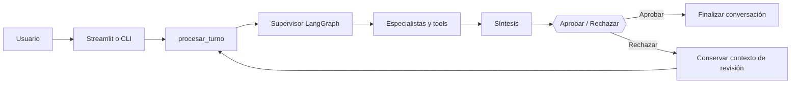

# 00. Producto y alcance

## Propósito

ReciclaTIA resuelve consultas sobre residuos domésticos y servicios de recogida de **Madrid ciudad**. El objetivo no es mantener una conversación general sobre sostenibilidad, sino dar respuestas contrastables con el corpus y, cuando proceda, con datos geográficos municipales.

El producto dispone de dos clientes: la web Streamlit (`app.py`) y la interfaz de terminal (`main.py`). Ambos invocan las mismas funciones de `src.agent` y comparten las reglas del grafo LangGraph. La interfaz no implementa políticas propias de recuperación, aprobación o herramientas.

## Casos cubiertos

| Necesidad | Comportamiento esperado |
|---|---|
| Saber dónde depositar un residuo | Recuperar documentación y responder con fuentes; abstenerse si la evidencia no basta |
| Entender modalidades de recogida | Consultar corpus municipal y distinguir fijo, móvil y proximidad |
| Localizar puntos limpios | Utilizar coordenadas aportadas voluntariamente y la tool geográfica |
| Consultar horarios | Mostrar horarios documentados; no garantizar apertura real |
| Analizar una fotografía | Describir materiales observables con visión, contrastar el destino por RAG |
| Corregir una recomendación | Rechazar el plan en HITL y reformular en el mismo hilo |

Fuera de alcance: otros municipios, reserva de servicios, geocodificación automática de direcciones, rutas por carretera, actualización permanente de horarios, automatización de recogidas y clasificación infalible de objetos por imagen.

## Recorrido funcional

El grafo solo pasa al nodo `aplicar` después de una decisión humana real. En este proyecto *aplicar* significa **registrar la decisión**, no ejecutar operaciones externas.

## Requisitos de comportamiento

1. Las respuestas sobre destinos de residuos deben apoyarse en resultados del RAG; no basta la inferencia del modelo.
2. Una fuente documental que no respalda la respuesta no puede utilizarse como prueba.
3. La búsqueda de proximidad no está autorizada sin coordenadas explícitas.
4. La misma consulta puede requerir un especialista o ambos. No se ejecutan los dos sistemáticamente.
5. El sistema distingue falta de evidencia, información parcial y error técnico.
6. La aprobación no se realiza automáticamente en la web ni en el modo interactivo. El modo demo admite `--auto-aprobar` explícito.
7. El rechazo permite un nuevo turno sin tratar los resultados anteriores como evidencia válida del nuevo pedido.
8. El historial depende de `MemorySaver` y tiene alcance **en memoria de proceso**.

## Criterios verificables

- El RAG puede utilizarse sin agente, a través de `src.rag.responder()` y comandos `main.py rag`.
- Los clientes consumen `procesar_turno()`, `aprobar_plan()` y `nuevo_thread_id()` sin ejecutar directamente tools.
- La web muestra los planes, las fuentes, el origen de los resultados geográficos y la decisión HITL.
- Se pueden ejecutar casos individuales de residuos, puntos, consulta compuesta, imagen y falta de evidencia.
- Las pruebas automatizadas y la revisión manual quedan descritas en `08-pruebas-y-validacion.md`.

## Componentes relacionados

`01-retrieval.md` (búsqueda), `02-mejoras-retrieval.md` (filtros y consultas estructuradas), `03-generacion.md` (citas), `04-consultas-generales.md` (intenciones), `05-tools.md` (herramientas), `06-langgraph.md` (orquestación), `07-streamlit.md` (interfaz), `09-datos-y-fuentes.md` (procedencia) y `10-seguridad.md` (controles).
