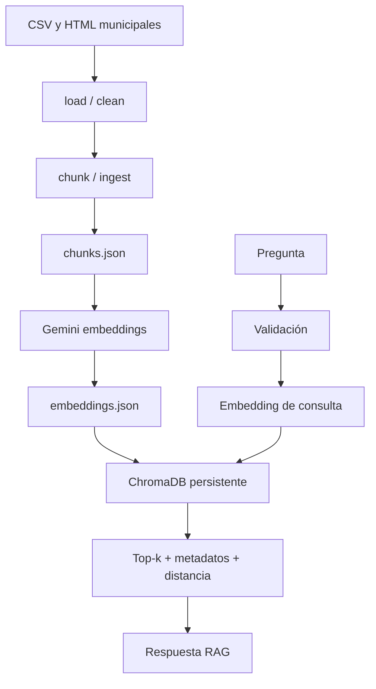

# 01. Pipeline documental y recuperación semántica

## Arquitectura

El RAG funciona de manera independiente de LangGraph. El corpus se prepara fuera del flujo conversacional; durante una consulta solo se recuperan los fragmentos necesarios.



## Configuración del repositorio

| Parámetro en `config.py` | Valor |
|---|---|
| `CHUNK_SIZE` | 1000 caracteres |
| `CHUNK_OVERLAP` | 100 caracteres |
| `EMBEDDING_MODEL` | `gemini-embedding-2` |
| `EMBEDDING_DIMENSIONS` | 768 |
| `CHROMA_COLLECTION_NAME` | `residuos_madrid` |
| `CHROMA_DISTANCE` | `cosine` |
| `TOP_K` | 5 |
| `MAX_TOP_K_RETRIEVAL` | 10 |
| `MAX_PREGUNTA_CARACTERES` | 500 |
| `MAX_CONTEXTO_CARACTERES` | 12000 |

Las dimensiones, el modelo y la colección deben coincidir con el índice creado. Cambiar el modelo de consulta sin reconstruir los embeddings haría que la recuperación no fuese compatible.

## Archivos y responsabilidad

| Archivo | Responsabilidad |
|---|---|
| `src/load.py` | Lectura del corpus |
| `src/clean.py` | Limpieza y normalización de HTML/CSV |
| `src/chunk.py` | Fragmentación |
| `src/ingest.py` | Orquestación de preparación de chunks |
| `src/embed.py` | Generación de vectores con Gemini |
| `src/index.py` | Índice persistente ChromaDB |
| `src/retrieve.py` | Búsqueda semántica top-k y filtros |
| `src/retrieve_structured.py` | Lecturas estructuradas del catálogo y las paradas |

## Contrato de búsqueda

```python
buscar_chunks_relevantes(
    pregunta: str,
    top_k: int = TOP_K,
    *,
    query_embedding: list[float] | None = None,
) -> list[dict]
```

El resultado de una búsqueda semántica mantiene esta forma:

```python
{
    "text": "...",
    "distance": 0.0,
    "metadata": {"source": "...", "path": "..."},
}
```

La distancia es la métrica de ChromaDB y sirve para ordenar y analizar los resultados; **no es una probabilidad de veracidad**. `query_embedding` permite inyectar un vector de prueba sin pedirlo a Gemini.

## Reglas de validación

- Pregunta no vacía y longitud dentro del límite.
- `top_k` entero dentro de los máximos.
- Dimensiones compatibles de cualquier embedding facilitado.
- Colección disponible y respuesta de ChromaDB válida.
- Metadatos originales conservados. Cuando una fuente no está documentada, no se fabrica.
- Error técnico explícito si la consulta no puede ejecutarse; nunca se reemplaza por resultados inventados.

## Reconstrucción

Desde la raíz:

```bash
python main.py rag index --yes
python main.py rag index --full --yes
```

El primer comando reconstruye el índice usando embeddings disponibles. El segundo rehace ingesta y embeddings antes de indexar, con consumo potencial de Gemini. No deben ejecutarse como parte de cada consulta.

## Verificación

- Una pregunta dentro del corpus devuelve fragmentos y fuentes utilizables.
- Un cambio de `top_k` altera como máximo el número solicitado, sin modificar el índice.
- Un embedding precalculado evita la llamada al proveedor.
- Las preguntas inválidas y colecciones ausentes no generan respuestas simuladas.
- Las comparaciones de ranking y distancias se registran en `tests/evaluate_retrieve.py`, distinguiendo coincidencia de fuente de corrección factual.
