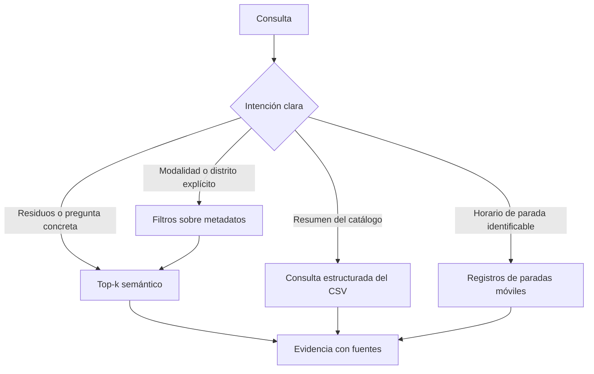

# 02. Recuperación filtrada y consultas estructuradas

## Por qué no basta con top-k

Una búsqueda vectorial puede recuperar documentos semánticamente próximos pero de la **modalidad o distrito equivocados**. Tampoco sirve devolver cinco filas aisladas de un CSV cuando se pide una descripción global del catálogo. Para esos casos se complementa la recuperación semántica con filtros y lectores estructurados.

No se sustituye ChromaDB por un motor léxico ni se inventa un ranking nuevo: se reutilizan los metadatos existentes.

## Filtros

El módulo `src/retrieve.py` reconoce términos explícitos y puede restringir ChromaDB por `document_type`, `district` o `source`. Se detectan primero las expresiones específicas, como *móvil 24 horas*, antes de las genéricas.

| Petición | Metadatos útiles |
|---|---|
| Punto limpio fijo | `document_type=punto_limpio_fijo` |
| Punto limpio móvil | `document_type=punto_limpio_movil` |
| Punto móvil 24 h | `document_type=punto_limpio_movil_24h` |
| Punto de proximidad | `document_type=punto_limpio_proximidad` |
| Distrito municipal reconocido | `district` |
| Relaciones residuo-destino | `source=tipos_residuos.csv` |

Los filtros de modalidad y distrito solo se combinan cuando ambos aparecen de forma inequívoca. Una petición ambigua no justifica adivinar el barrio o convertirlo en distrito. Si una búsqueda estricta no obtiene registros, **no se devuelven silenciosamente puntos de otra modalidad**.

## Catálogo de residuos

`tipos_residuos.csv` contiene **relaciones de residuos con destinos de depósito**. No es, por sí mismo, una taxonomía universal de todos los residuos reconocidos por el Ayuntamiento.

Las consultas que piden categorías, destinos o recuentos globales se resuelven mediante acceso estructurado al índice (`src/retrieve_structured.py`), agrupando metadatos y conservando los registros de origen. No se debe presentar un top-5 de relaciones como si fuese un listado exhaustivo.

Los agregados deben indicar el conjunto del que proceden. Si se muestran ejemplos, tienen que existir literalmente en los registros; las cantidades se calculan, no se fijan en la documentación como constantes.

## Paradas móviles y horarios

Los horarios de las unidades móviles pertenecen a **paradas concretas**. `retrieve_structured.py` permite consultar esos datos con dirección, distrito, día y modalidad; `src/rag_intents.py` determina cuándo conviene esa vía y cuándo hay que solicitar una ubicación más precisa.

Una pregunta «¿qué horario tiene el punto limpio móvil?» no identifica necesariamente una parada. Si el corpus no permite resolverla, se pide calle, parada o distrito; no se mezclan horarios de instalaciones distintas.

## Separación de responsabilidades

- `retrieve.py` recupera evidencia semántica con filtros.
- `retrieve_structured.py` lee agregaciones y filas estructuradas.
- `rag_intents.py` reconoce las consultas que requieren esas vías.
- `rag.py` decide cómo obtener la respuesta pública.
- `generate.py` redacta cuando corresponde; no abre ChromaDB.

Ninguna capa debe afirmar que una fuente recuperada implica automáticamente una recomendación correcta.

## Pruebas relevantes

`tests/test_retrieve.py`, `tests/test_retrieve_structured.py`, `tests/test_rag_structured.py` y `tests/evaluate_retrieve.py` comprueban filtros, rutas y regresiones. Los criterios principales son correspondencia de **fuente + modalidad + distrito**, ausencia de sustituciones silenciosas y preservación del contrato del RAG. La evaluación debe registrar por separado `hit@k`, respuestas vacías y pertinencia real.
