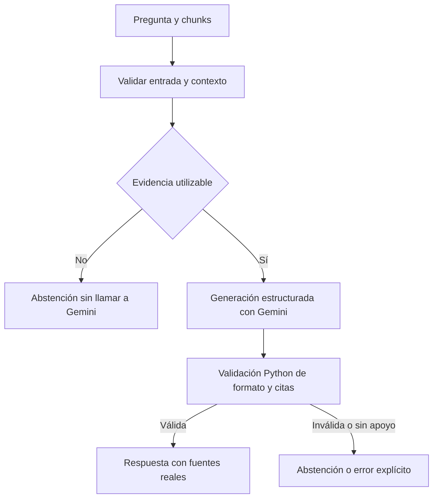

# 03. Generación de respuestas y control de evidencia

## Función del módulo

La generación transforma los fragmentos documentales en una respuesta entendible sin introducir destinos, horarios o condiciones que no aparezcan respaldados por las fuentes.

`src/generate.py` trabaja con una pregunta y los chunks recuperados. No indexa documentos, no decide qué especialista se ejecuta y no contiene lógica de Streamlit.



## Contratos principales

```python
generar_respuesta(
    pregunta: str,
    chunks: list[dict],
    *,
    client=None,
) -> dict
```

Estructura pública utilizada por la generación:

```python
{
    "respuesta": "Texto sustentado [C1]",
    "abstencion": False,
    "motivo": None,
    "fuentes": [
        {"chunk_id": "C1", "source": "archivo.csv", "path": "data/raw/csv/archivo.csv"}
    ],
}
```

Los identificadores `C1`, `C2`, etc. pertenecen al contexto construido **durante esa llamada**. Las referencias de salida se generan desde los metadatos de los chunks que se entregaron realmente, no desde rutas sugeridas por Gemini.

La API RAG de nivel superior es `src.rag.responder()`, que añade pregunta, chunks y métricas. Los tests de integración no deben confundir ese contrato con el del generador.

## Preparación del contexto

- Descartar documentos vacíos o con estructura incorrecta.
- Respetar el máximo de contexto configurado (`MAX_CONTEXTO_CARACTERES=12000`).
- Mantener identificadores y fuentes trazables.
- Presentar los documentos al modelo como **datos**, no como instrucciones.
- Conservar condiciones y excepciones de la fuente, particularmente horarios y modalidades de recogida.
- No reducir pertinencia a un único valor de distancia coseno.

## Política de respuesta

1. Clasificar o recomendar destinos únicamente cuando la evidencia sea suficiente.
2. Solicitar una aclaración cuando falta una característica decisiva del residuo.
3. Reconocer la ausencia de datos en vez de completar por semejanza o conocimiento general.
4. Mantener la cobertura geográfica de **Madrid ciudad**.
5. Conservar las referencias documentales de afirmaciones importantes.
6. No atribuir apertura «ahora» a un establecimiento por el mero hecho de disponer de un horario general.
7. Rechazar instrucciones incrustadas en los documentos recuperados que intenten cambiar la conducta del agente.

Una respuesta afirmativa sin referencias válidas no cumple el contrato. Del mismo modo, citar un archivo correctamente no demuestra que cualquier inferencia sobre él sea válida: las pruebas deben revisar el contenido concreto.

## Abstención frente a fallo técnico

Motivos semánticos como `sin_contexto`, `evidencia_insuficiente`, `fuera_de_dominio` y `ambiguedad` expresan limitaciones de la información. Un error HTTP, de cuota, del SDK o un JSON inválido persistente no puede presentarse como si el corpus careciera de evidencia; se maneja como fallo técnico.

## Integración con la síntesis multiagente

`src/nodes.py` evita volver a invocar Gemini cuando ya existe una **respuesta RAG completa, citada y suficiente** de un único especialista. Para consultas compuestas, los módulos `src/agent_resultado.py` y `src/agent_schedule.py` pueden integrar datos geográficos y horarios comprobados sin inventar nuevas fuentes. Cuando la integración directa no es aplicable, la síntesis utiliza el LLM y verifica que el plan resultante tenga pasos válidos antes de HITL.

## Verificación

- Ausencia de contexto: abstención sin llamada externa.
- Salida estructurada correcta: respuesta y fuentes conservadas.
- Citas inventadas, sin soporte o mal formadas: no aceptadas.
- Consulta de otro municipio: no extrapolación.
- Información contradictoria: pedir aclaración o abstenerse.
- Error transitorio del proveedor: reintentos limitados y error distinguible.

Pruebas: `tests/test_generate.py`, `tests/test_rag.py`, `tests/test_agent_resultado.py` y, para evaluación real controlada, `tests/evaluate_rag.py`.
