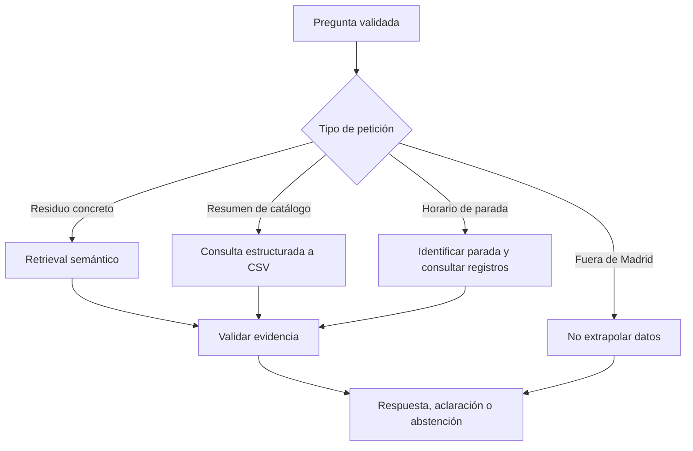

# 04. Interpretación de consultas y datos estructurados

## Objetivo

El RAG no debe tratar de la misma manera una pregunta sobre un objeto concreto, una petición de catálogo y una consulta sobre el horario de una instalación. Cada una requiere un tipo de evidencia y una estrategia de respuesta distintos.

## Rutas de consulta

La detección conservadora de intenciones se concentra en `src/rag_intents.py`. `src/rag.py` orquesta la vía elegida y mantiene el contrato público de `responder()`.

## Catálogo municipal

El archivo `tipos_residuos.csv` contiene asociaciones entre residuos y **destinos**. Cuando se pide una visión general, el módulo estructurado agrupa las relaciones disponibles; no crea una categoría «oficial» por cada similitud léxica ni presenta un subconjunto como inventario exhaustivo.

La respuesta debe conservar la procedencia del CSV e indicar que las categorías se refieren al contenido del corpus. Una consulta sobre una botella, una pila u otro residuo individual sigue la vía que mejor permita fundamentar ese objeto, en lugar de listar todo el catálogo.

## Puntos limpios móviles

Los registros pueden incluir calle, distrito, día y franja horaria. El horario solo puede atribuirse a la parada a la que pertenece. Para una pregunta sin parada identificable, la acción segura es pedir un dato adicional. Las modalidades fijo, móvil, móvil 24 horas y proximidad no son intercambiables.

La búsqueda geográfica por coordenadas la ejecuta otra herramienta (`buscar_puntos_limpios_cercanos`); no forma parte del RAG semántico.

## Horarios y decisiones temporales del agente

`src/agent_schedule.py` recoge las comprobaciones de tiempo que no deben dejarse a una inferencia libre del modelo:

- Determina si una consulta necesita la hora local (`hora_actual`).
- Interpreta intervalos diarios o semanales, incluyendo los que cruzan la medianoche.
- Distingue `dentro`, `fuera` y `desconocido` en relación con **el horario publicado**.
- Evita afirmar que un punto está abierto físicamente basándose solo en ese resultado.
- Prioriza los candidatos cuando el pedido requiere disponibilidad horaria, manteniendo la distancia geográfica como criterio verificable.
- Si el usuario pide expresamente ordenar por cercanía, respeta esa preferencia y muestra la situación horaria sin sustituir el criterio.

Existe una regla específica para **envases de vidrio**, que compara la hora de Madrid con la franja municipal recogida por `FUENTE_HORARIO_VIDRIO`. Solo se activa cuando la clasificación del RAG permite identificar envases de vidrio destinados al contenedor verde. No se extiende por parecido a vasos, espejos o vitrocerámicas.

`src/agent_resultado.py` puede integrar, sin nuevas llamadas a herramientas, una clasificación documentada, los puntos hallados, sus distancias y la evaluación horaria. Si no se puede determinar que una instalación esté dentro del horario publicado, se expresa como limitación.

## Consulta compuesta

«¿Dónde tiro este objeto y qué punto limpio me queda cerca?» requiere en general dos tipos de evidencia: la clasificación del residuo y la búsqueda de instalaciones compatibles. El supervisor decide los especialistas necesarios, pero la composición final no debe convertir la mera cercanía en prueba de que un centro acepte un residuo concreto.

## Criterios de aceptación

1. Una consulta general de catálogo no queda reducida a un top-k arbitrario.
2. Una pregunta de horario ambiguo no recibe horarios mezclados de distintas paradas.
3. Un municipio distinto de Madrid no recibe reglas municipales de Madrid como válidas para él.
4. Las modalidades y sus filtros se mantienen independientes.
5. Los estados horarios se limitan a la documentación y la hora facilitada por la herramienta.
6. La prioridad por horario y la prioridad por distancia son comportamientos distinguibles y probables mediante tests.
7. El contrato público `responder()` conserva respuesta, abstención, motivo, fuentes, chunks y métricas.

Pruebas: `tests/test_rag_structured.py`, `tests/test_rag_domain.py`, `tests/test_agent_schedule.py`, `tests/test_agent_schedule_integration.py` y `tests/test_agent_resultado.py`.
