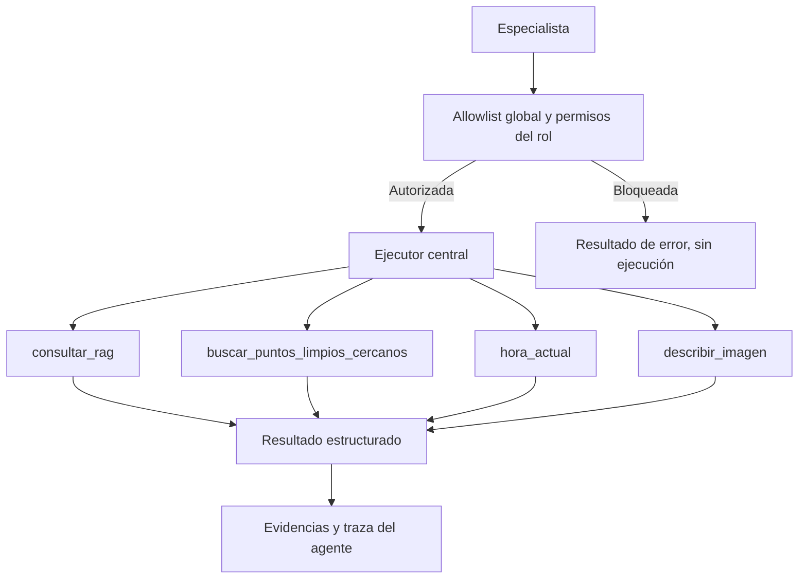

# 05. Herramientas, contratos y permisos

## Separación de responsabilidades

Las herramientas son capacidades independientes del grafo. LangGraph no realiza HTTP ni consulta ChromaDB por su cuenta: selecciona una herramienta registrada y la ejecuta mediante `src/tools/__init__.py`.



## Inventario

| Nombre de tool | Función real | Especialista permitido |
|---|---|---|
| `consultar_rag` | Llama a `src.rag.responder()` y devuelve su contrato completo | `residuos`, `puntos` |
| `buscar_puntos_limpios_cercanos` | Consulta ArcGIS municipal, calcula proximidad y usa respaldo local en error técnico | `puntos` |
| `hora_actual` | Obtiene fecha/hora de `Europe/Madrid` | `puntos` |
| `describir_imagen` | Analiza una imagen JPEG/PNG con Gemini | `residuos` |

La lista global es `TOOLS`; `TOOL_BY_NAME` asocia cada nombre con su herramienta. Los permisos adicionales están centralizados en `config.AGENT_TOOLS_BY_ROLE`.

## Contratos de las herramientas

### `consultar_rag(pregunta: str) -> dict`

Conserva los campos de `responder()` (respuesta, fuentes, chunks, motivo, abstención y métricas). No interpreta su abstención como un fallo HTTP ni elimina citas al entregarlas al especialista. La recuperación y generación siguen dentro del RAG.

### `buscar_puntos_limpios_cercanos(latitud, longitud, radio_metros=2000, tipo="todos") -> dict`

Consulta el servicio ArcGIS:

`https://sigma.madrid.es/hosted/rest/services/RESIDUOS/PUNTOS_LIMPIOS/MapServer/5/query`

Parámetros: coordenadas WGS84 (`EPSG:4326`), radio entero entre 1 y 5000 metros, modalidad `todos|fijo|movil|proximidad`. La respuesta normaliza la información disponible, calcula **Haversine**, ordena por distancia ascendente, limita la presentación a 10 puntos e informa del número total de coincidencias.

```python
{
    "fuente": "api",  # o "corpus_local"
    "tipo_solicitado": "proximidad",
    "radio_metros": 2000,
    "total_encontrados": 0,
    "puntos": [],
    "aviso": None,
}
```

Un fallo técnico de la API habilita una búsqueda sobre los registros locales de ChromaDB. Una **respuesta válida con cero puntos** no debe activar ese respaldo. La fuente aparece en el resultado; el corpus local puede estar desactualizado. Ni Haversine ni el horario documentado calculan rutas o apertura en tiempo real.

### `hora_actual() -> str`

Devuelve una marca horaria ISO con zona `Europe/Madrid`. No consulta la red. El resultado permite comparar franjas documentadas, pero no demuestra que una instalación esté operativa.

### `describir_imagen(ruta_imagen: str) -> str`

Acepta rutas dentro de `assets/`; valida extensión, formato real JPEG/PNG, tamaño máximo de 5 MiB y hasta 16 millones de píxeles. La imagen se envía a Gemini para describir los objetos visibles. **No determina por sí sola un contenedor**; esa atribución requiere evidencia documental.

La interfaz almacena temporalmente las imágenes subidas dentro de `assets/.streamlit_temporal/` y elimina el archivo al finalizar la consulta. La validación de la tool sigue siendo obligatoria aunque la UI haya comprobado previamente el archivo.

## API de ejecución

Para conservar compatibilidad con el RAG y el uso independiente de herramientas:

```python
ejecutar_tool(nombre: str, args: dict | None = None) -> str
```

El agente usa la variante estructurada con permisos de rol:

```python
ejecutar_tool_estructurado(
    nombre: str,
    args: dict | None = None,
    *,
    rol: Literal["residuos", "puntos"],
) -> ResultadoTool
```

```python
{
    "ok": True,
    "nombre": "consultar_rag",
    "datos": {"respuesta": "...", "fuentes": []},
    "error": None,
}
```

`datos` mantiene su tipo original. No se hace `eval()` ni se parsean representaciones textuales de objetos Python para recuperar un `dict`.

## Controles de ejecución

- La herramienta debe existir en la allowlist global.
- El rol solo puede utilizar sus herramientas autorizadas.
- Los nombres y parámetros desconocidos se rechazan antes de la invocación.
- `src/agent_tool_loop.py` aplica presupuestos en Python de pasos LLM y llamadas reales; el modelo no puede ampliarlos con instrucciones.
- Una ejecución denegada, fallida o limitada queda reflejada en la traza sin publicar claves ni contenidos íntegros de imágenes.
- Los fallos técnicos no se presentan como respuestas satisfactorias.

## Pruebas

`tests/test_tools_registry.py`, `tests/test_rag_tool.py`, `tests/test_api_puntos_limpios.py`, `tests/test_describir_imagen.py` y `tests/test_hora_actual.py`. Deben cubrir validaciones, permisos, respaldo y diferencias entre fuente real y corpus local con mocks. Las integraciones con servicios externos se comprueban por separado.
