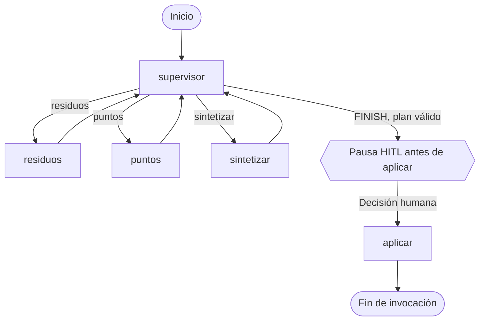
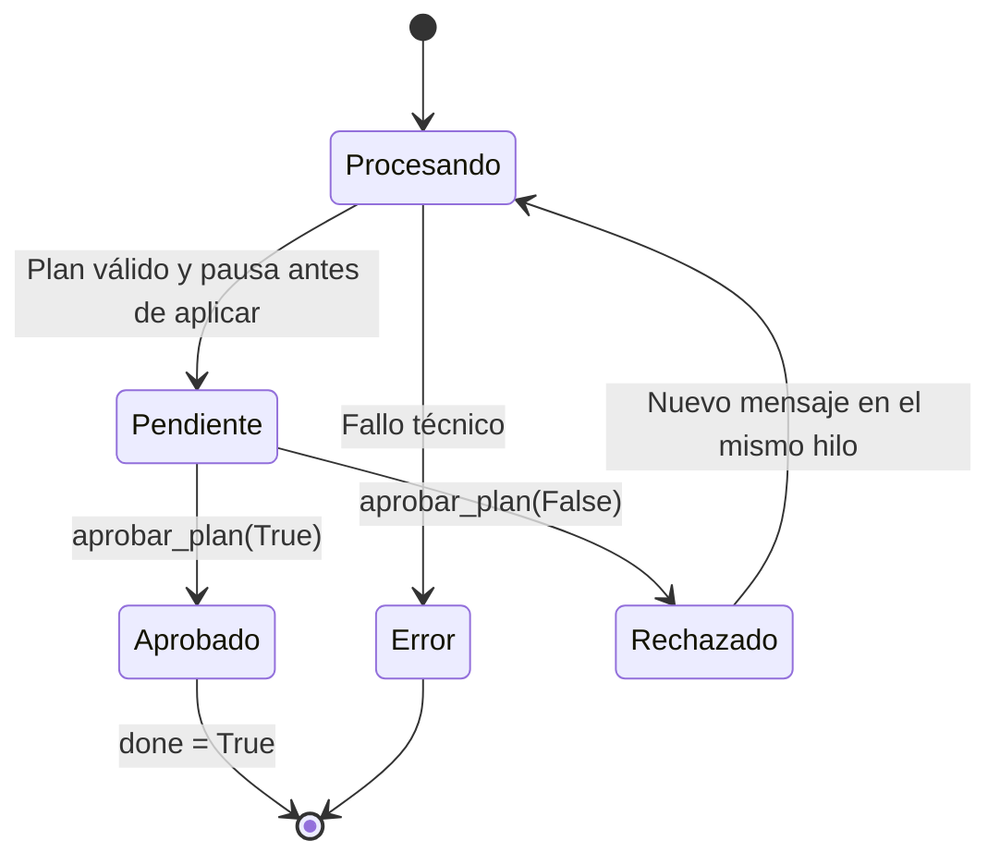

# 06. LangGraph, estado y aprobación humana

## Diseño general

El RAG continúa siendo autónomo. La capa multiagente organiza el trabajo y añade control de herramientas, memoria por hilo y revisión humana.



En `src/graph.py`, `build_graph()` registra `supervisor`, `residuos`, `puntos`, `sintetizar` y `aplicar`, utiliza `StateGraph(EstadoGrafo)` y compila con `MemorySaver()` e `interrupt_before=["aplicar"]`. `get_app()` mantiene una instancia compilada compartida por proceso mediante caché. `config_hilo()` incorpora el `thread_id` y el límite de recursión.

**El diagrama representa el camino funcional, no una garantía de ejecutar siempre ambos especialistas.** El enrutamiento decide lo necesario para la petición; los nodos de trabajo regresan al supervisor hasta completar el pedido.

## Responsabilidades

| Módulo | Propósito |
|---|---|
| `src/state.py` | Tipos de estado, fábrica, reinicio de turnos y adaptación al cliente |
| `src/agent_routing.py` | Intenciones, enrutamiento y fallback del supervisor |
| `src/agent_prompts.py` | Instrucciones diferenciadas para los roles |
| `src/agent_tool_loop.py` | Ejecución de tools, permisos, presupuestos y registro de evidencia |
| `src/nodes.py` | Cinco nodos, diagnóstico de suficiencia y síntesis |
| `src/agent_schedule.py` | Comprobaciones de horarios publicadas y priorización temporal |
| `src/agent_resultado.py` | Integración de clasificación, puntos y horarios en una respuesta |
| `src/graph.py` | Aristas, compilación, checkpoint e interrupción |
| `src/agent.py` | Entrada pública de consultas, aprobación y demo |

## Contrato público del orquestador

```python
procesar_turno(
    estado: EstadoProducto,
    mensaje: str,
    thread_id: str,
    *,
    max_steps: int | None = None,
    ubicacion: Ubicacion | None = None,
    ruta_imagen: str | None = None,
) -> EstadoProducto

aprobar_plan(
    thread_id: str,
    aprobado: bool,
    estado: EstadoProducto,
) -> EstadoProducto

nuevo_thread_id() -> str
```

`Ubicacion` contiene latitud y longitud suministradas. La interfaz no las obtiene automáticamente. `crear_estado_producto()` prepara un hilo nuevo; `estado_desde_grafo()` traduce el estado persistido para Streamlit y CLI.

## Estado y continuidad

El estado agrupa:

- **Pedido y contexto:** consulta, mensaje original y contexto limitado de una revisión rechazada.
- **Selección:** especialidades necesarias y completadas, `siguiente` e `iteracion`.
- **Evidencia:** datos de las herramientas, fuentes, notas, limitaciones, `abstencion`, `motivo` y `estado_evidencia`.
- **Salida:** `respuesta` y `plan`.
- **Control:** `max_steps`, `max_turns`, `turnos_consumidos`, `tool_calls_turno`, `pendiente_hitl`, `plan_aprobado`, `done` y `error`.
- **Observabilidad:** `log`, `traza_tools` e historial acotado.

Al empezar un turno se limpian los campos de trabajo transitorios. Tras un rechazo se conserva lo necesario para comprender «cambia el distrito», pero **las evidencias antiguas no se consideran pruebas del nuevo turno**. Un `thread_id` distinto no debe heredar el estado de otro hilo.

`MemorySaver` almacena checkpoints **en memoria RAM del proceso**. No garantiza continuidad después de reiniciar Streamlit o la terminal.

## Supervisor y especialistas

El supervisor escoge entre `residuos`, `puntos`, `sintetizar` y `FINISH`. Si Gemini no devuelve una decisión válida, las reglas Python de `src/agent_routing.py` determinan un destino seguro. Una consulta que necesita ambas especialidades no puede sintetizarse hasta que consten las dos como atendidas.

`residuos` puede consultar el RAG y describir imágenes. `puntos` puede consultar el RAG, la API geográfica y la hora de Madrid. Los permisos son explícitos: el modelo no dispone libremente de las cuatro herramientas.

`src/agent_tool_loop.py` tiene una **ruta directa** para consultas en las que basta una herramienta y una ruta con selección por el modelo para casos menos evidentes. Ambas comparten controles y trazas. Las comprobaciones de tiempo y la respuesta geográfica integrada se ejecutan con evidencia ya obtenida; no deben introducir llamadas o datos ocultos.

## HITL: transición de estados



Invariantes del ciclo:

1. `pendiente_hitl=True` corresponde a una pausa real del checkpoint antes de `aplicar`, no únicamente a un flag de interfaz.
2. Durante la pausa no se admiten nuevos mensajes ordinarios.
3. `aprobar_plan()` comprueba el checkpoint y que el plan mostrado coincide con el almacenado.
4. Tras una decisión válida, el cliente actualiza `plan_aprobado` y reanuda con `invoke(None)`.
5. Solo el nodo `aplicar` registra `done=True` después de una aprobación.
6. Rechazar retira el plan vigente y permite reformular en el mismo hilo.
7. Aprobar **no ejecuta acciones físicas ni herramientas adicionales**; el nodo registra la aceptación.
8. Si la reanudación falla, no se comunica éxito anticipadamente.

## Límites de ejecución

| Constante | Valor |
|---|---:|
| `MAX_ITER` | 8 decisiones del supervisor |
| `MAX_STEPS_DEFAULT` / `MAX_STEPS_LIMIT` | 4 / 8 rondas por especialista |
| `MAX_TOOL_CALLS_PER_SPECIALIST` | 8 llamadas |
| `MAX_TOOL_CALLS_PER_TURN` | 12 llamadas |
| `MAX_TURNS_DEFAULT` / `MAX_TURNS_LIMIT` | 6 / 12 consultas |
| `MAX_HISTORY_TURNS` | 6 turnos conservados |
| `GRAPH_RECURSION_LIMIT` | `2 * MAX_ITER + 8` |

Los límites se imponen desde Python, también cuando una respuesta del LLM incluye varias llamadas a herramientas. El cliente no puede elevarlos sin respetar la validación del backend. Una aprobación o rechazo no suma otra consulta.

## Manejo de errores y evidencia

`estado_evidencia` distingue información suficiente, parcial o insuficiente. Un resultado del RAG abstentivo no se reescribe como si fuese un resultado positivo; un fallo técnico no debe transformarse en abstención documental. Las limitaciones se exponen al sintetizar.

La síntesis directa reutiliza resultados ya fundamentados cuando basta una sola evidencia. Para pedidos geográficos, la respuesta compuesta utiliza distancia y horarios documentados, diferenciando fuentes `api` y `corpus_local`. En los demás casos, una síntesis con Gemini debe superar validaciones antes de quedar pendiente de HITL.

## Pruebas de contrato

- Solicitud de solo residuos: no ejecutar puntos innecesariamente.
- Solicitud de solo puntos: no ejecutar clasificación sin motivo.
- Consulta mixta: completar ambas especialidades.
- Respuesta inválida del supervisor: fallback seguro.
- Presupuesto agotado: no ejecutar llamadas adicionales.
- Hilos diferentes: aislamiento de estado.
- HITL: aprobar, rechazar y reintentar sin saltarse `aplicar`.
- Errores: no marcar `done=True` ni presentar plan ficticio.

Pruebas relacionadas: `tests/test_agent_regression.py`, `tests/test_agent_resultado.py`, `tests/test_agent_schedule.py` y `tests/test_agent_schedule_integration.py`.
