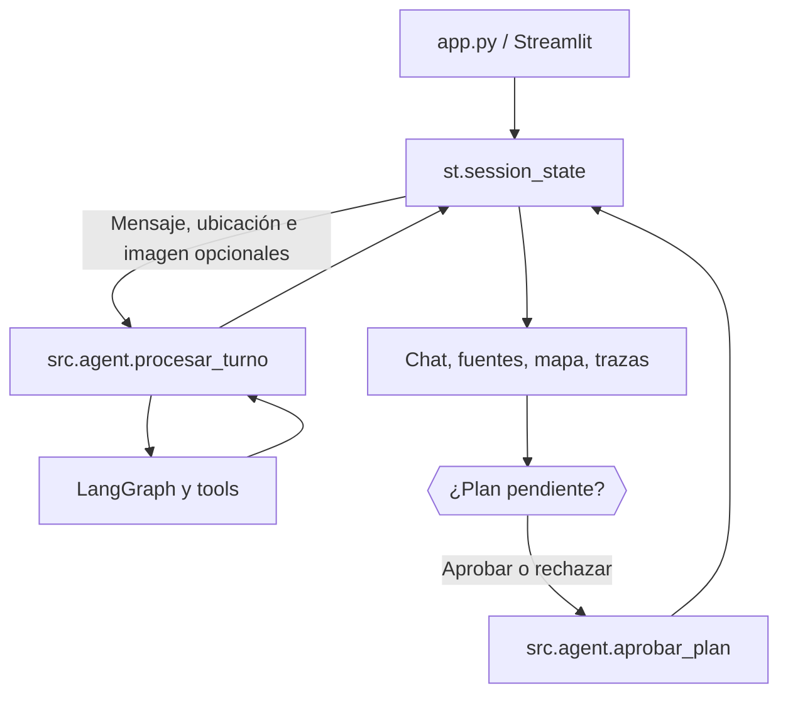

# 07. Cliente web Streamlit

## Responsabilidad

`app.py` es la interfaz del usuario, no una segunda implementación del agente. Presenta conversaciones, fuentes, mapas, entrada de imágenes, opciones de ubicación y botones HITL. Toda consulta pasa por `src.agent.procesar_turno()` y toda decisión humana por `src.agent.aprobar_plan()`.



Streamlit no ejecuta directamente `build_graph`, `nodes.py` ni herramientas individuales. Tampoco debe reconstruir el estado a partir de textos visibles: utiliza `EstadoProducto`.

## Estado de sesión

El código agrupa las claves con prefijo `rt_` para evitar colisiones. Entre las principales están:

| Clave | Contenido |
|---|---|
| `rt_thread_id` | Identificador de conversación para LangGraph |
| `rt_estado` | Último estado público retornado por el orquestador |
| `rt_mensajes` | Mensajes y resultados presentados en el chat |
| `rt_max_turns`, `rt_max_steps` | Límites ajustables dentro de los valores de `config.py` |
| `rt_usar_ubicacion` | Autorización explícita de coordenadas |
| `rt_latitud`, `rt_longitud` | Valores introducidos o editados por el usuario |
| `rt_mostrar_mapa`, `rt_mostrar_debug` | Opciones de visualización |
| `rt_version_imagen` | Identificador para limpiar el cargador al cambiar el turno |

`_nueva_conversacion()` genera un nuevo `thread_id`, crea `EstadoProducto`, limpia los mensajes y desactiva de nuevo el uso de ubicación. Los ajustes no sensibles pueden mantenerse; los resultados y permisos del hilo anterior no deben heredarse.

## Entradas

### Texto

`st.chat_input` recoge preguntas con un máximo de 500 caracteres. No se permite enviar una nueva consulta mientras hay HITL pendiente, después de aprobar o al agotar los turnos autorizados. El backend repite estas comprobaciones y valida la pregunta; desactivar un botón no se considera una medida de seguridad suficiente.

### Ubicación

La geolocalización es manual y voluntaria. El valor inicial de ejemplo (centro de Madrid) **no procede del dispositivo** y no puede utilizarse si el control «Aportar coordenadas» está desactivado. `_ubicacion()` valida finitud y rangos numéricos antes de entregar latitud y longitud al orquestador.

### Imágenes

`_guardar_imagen()` lee el archivo subido, comprueba extensión/formato, límite de 5 MiB y hasta 16 megapíxeles, y escribe una copia temporal con nombre aleatorio bajo `assets/.streamlit_temporal/`. `procesar_turno` recibe la ruta; `_limpiar_imagen` intenta eliminarla en el bloque `finally`. Una terminación brusca del proceso puede impedir la limpieza, de modo que esta medida no equivale a una garantía de borrado permanente de cualquier residuo de disco.

El análisis visual se efectúa con Gemini; la UI no convierte lo descrito en una clasificación documental válida.

## Presentación

- **Chat:** respuestas y planes tal como los devuelve el estado del agente.
- **Fuentes:** referencias documentales recuperadas; una ausencia de fuentes se muestra como tal.
- **Geografía:** tabla de dirección, modalidad, horario y distancia. El mapa usa las coordenadas devueltas por la herramienta.
- **Procedencia:** etiqueta `api` o `corpus_local`, con aviso de posible desactualización para este último.
- **Diagnóstico:** flags, `thread_id`, log de nodos y traza de tools, activado desde la barra lateral.
- **Estado HITL:** acciones Aprobar/Rechazar tanto en la barra lateral como en el área central mientras el checkpoint espera una decisión.

La interfaz distingue horarios publicados de apertura física. Una distancia en metros indica proximidad geográfica, no un tiempo de desplazamiento.

## Reglas para HITL

1. No mostrar aprobación si `pendiente_hitl` no es verdadero o hay un error que lo impida.
2. Invocar `aprobar_plan()` con el estado del hilo y actualizar `rt_estado` solo con su retorno.
3. Registrar la decisión visual correspondiente al plan mostrado.
4. Tras aprobar, cerrar el hilo; tras rechazar, habilitar una nueva consulta en el mismo hilo.
5. Si LangGraph devuelve error, la interfaz no debe presentar éxito ficticio.

## Comprobación de la UI

```bash
python -m py_compile app.py
python -m streamlit run app.py
```

Casos manuales: chat de ejemplo, archivo no válido, geolocalización desactivada, búsqueda con coordenadas, visualización del mapa y procedencia, diagnóstico, aprobación, rechazo y nueva conversación. Revisar el panel junto con la traza: **una interfaz que muestra un resultado no acredita por sí sola qué herramienta se ejecutó**.

## Límites conocidos

No hay cuentas de usuario, persistencia en disco de conversaciones, GPS automático, geocodificación de direcciones, ni rutas a pie/coche. La aplicación requiere ejecución local o un despliegue explícito con configuración de secretos y recursos. El alcance es únicamente Madrid ciudad.
