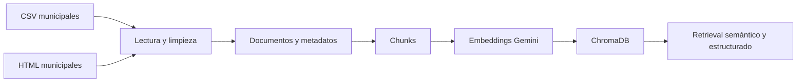

# 09. Corpus, procedencia y fuentes externas

## Dominio

El corpus local cubre gestión de residuos y puntos limpios de **Madrid ciudad**. No se trata de un catálogo universal de reciclaje ni de una API actualizada de forma continua. Las respuestas deben mantener el ámbito territorial de los archivos de origen.

## Contenido de `data/raw/`

Los ficheros incluidos en el corpus se agrupan así:

| Formato | Archivos | Uso |
|---|---|---|
| CSV | `tipos_residuos.csv` | Relaciones residuo-destino para recuperación y catálogo |
| CSV | `puntos_limpios_fijos.csv` | Datos documentados de puntos fijos |
| CSV | `puntos_limpios_moviles.csv` | Paradas y horarios de puntos móviles |
| CSV | `puntos_limpios_moviles_24h.csv` | Modalidad móvil 24 horas diferenciada |
| CSV | `puntos_limpios_proximidad.csv` | Puntos de proximidad |
| HTML | `fraccion_organica.html`, `fraccion_papel.html`, `fraccion_plasticos_metales_briks.html`, `fraccion_resto.html`, `fraccion_vidrio.html` | Información municipal sobre fracciones de recogida |
| HTML | `recogida_aceite_vegetal.html`, `recogida_muebles_enseres.html` | Recogidas específicas |
| HTML | `residuos_punto_limpio_fijo.html`, `residuos_punto_limpio_movil.html`, `residuos_punto_limpio_proximidad.html` | Residuos admitidos por modalidad |

Las carpetas `data/raw/pdf/` y `data/raw/txt/` existen, pero no contienen documentos. Al ser un proyecto académico se mantienen por ser tipos de fichero muy habituales.

## Transformación e indexación

Los metadatos relevantes incluyen `source`, `path`, `document_type`, `district`, `destino` y, cuando proceda, referencias a filas originales. El campo disponible depende del origen. Las transformaciones preservan el vínculo con el archivo; la generación y el agente no deben inventar procedencias.

La base local utiliza la colección `residuos_madrid`, similitud coseno y vectores de 768 dimensiones configurados en `config.py`. Si el corpus o el modelo de embeddings cambia, la reconstrucción tiene que ser consistente.

## API externa

La herramienta `buscar_puntos_limpios_cercanos` consulta un endpoint ArcGIS REST del Ayuntamiento de Madrid:

[API municipal de puntos limpios](https://sigma.madrid.es/hosted/rest/services/RESIDUOS/PUNTOS_LIMPIOS/MapServer/5/query)

Se solicita geometría WGS84 y se ordena el resultado por distancia Haversine. Cuando el servicio falla por causas técnicas, la herramienta utiliza registros geográficos extraídos del corpus local. La fuente debe ser explícita: `api` o `corpus_local`.

Una respuesta de la API sin puntos dentro del radio es un resultado vacío legítimo, no justifica activar el respaldo. Tampoco se afirma que una dirección, un servicio u horario estén operativos actualmente solo porque figuren en el resultado.

## Fuentes de horario

Los horarios de instalaciones proceden de los registros disponibles. Además, `src/agent_schedule.py` incorpora una regla para el depósito de envases de vidrio, asociada a la [página municipal de recogida de vidrio](https://www.madrid.es/portales/munimadrid/es/Recogida-de-vidrio/). El sistema compara la hora local con esa franja documentada, pero no interpreta situaciones no cubiertas por la fuente.

## Fuentes CSV — Portal de Datos Abiertos del Ayuntamiento de Madrid

| Archivo en el proyecto | Fuente oficial |
|---|---|
| `puntos_limpios_fijos.csv` | [Puntos limpios fijos](https://datos.madrid.es/dataset/200284-0-puntos-limpios-fijos) |
| `puntos_limpios_moviles.csv` | [Puntos limpios móviles](https://datos.madrid.es/dataset/300101-0-puntos-limpios-moviles) |
| `puntos_limpios_moviles_24h.csv` | [Puntos limpios móviles 24 horas](https://datos.madrid.es/dataset/900026-0-puntos-limpios-residuos) |
| `puntos_limpios_proximidad.csv` | [Puntos limpios de proximidad](https://datos.madrid.es/dataset/300198-0-puntos-proximidad) |
| `tipos_residuos.csv` | [Tipos de residuos y dónde depositarlos](https://datos.madrid.es/dataset/300199-0-tipo-residuo) |

Los conjuntos de Datos Abiertos anteriores indican licencia **Creative Commons Attribution 4.0 International (CC BY 4.0)** en sus fichas oficiales.

## Fuentes HTML — Ayuntamiento de Madrid

| Archivo en el proyecto | Página municipal de origen |
|---|---|
| `fraccion_organica.html` | [Recogida de residuos orgánicos](https://www.madrid.es/portales/munimadrid/es/Recogida-de-residuos-organicos/?vgnextchannel=f81379ed268fe410VgnVCM1000000b205a0aRCRD&vgnextoid=12bc51e3f7bee510VgnVCM1000001d4a900aRCRD) |
| `fraccion_papel.html` | [Recogida de la fracción papel y cartón](https://www.madrid.es/portales/munimadrid/es/Inicio/El-Ayuntamiento/Moratalaz/Recogida-de-la-fraccion-papel-y-carton/?vgnextchannel=7cb0ca5d5fb96010VgnVCM100000dc0ca8c0RCRD&vgnextfmt=default&vgnextoid=d9eb6c9c78eb2910VgnVCM2000001f4a900aRCRD) |
| `fraccion_plasticos_metales_briks.html` | [Recogida de plásticos, metales y briks](https://www.madrid.es/portales/munimadrid/es/Recogida-de-plasticos-metales-y-briks-Horarios-y-frecuencias-de-recogida-/?vgnextchannel=3dfcbb21278fe410VgnVCM1000000b205a0aRCRD&vgnextfmt=default&vgnextoid=54c4ebd9be6e8610VgnVCM1000001d4a900aRCRD) |
| `fraccion_resto.html` | [Recogida de la fracción resto no reciclable](https://www.madrid.es/portales/munimadrid/es/Recogida-fraccion-resto-no-reciclable-y-horario/?vgnextchannel=f81379ed268fe410VgnVCM1000000b205a0aRCRD&vgnextoid=61c4ebd9be6e8610VgnVCM1000001d4a900aRCRD) |
| `fraccion_vidrio.html` | [Recogida de vidrio](https://www.madrid.es/portales/munimadrid/es/Recogida-de-vidrio/?vgnextchannel=f81379ed268fe410VgnVCM1000000b205a0aRCRD&vgnextoid=e3ab6c9c78eb2910VgnVCM2000001f4a900aRCRD) |
| `recogida_aceite_vegetal.html` | [Recogida de aceite vegetal usado](https://www.madrid.es/portales/munimadrid/es/Inicio/Medio-ambiente/Recogida-de-residuos/Recogida-de-aceite-vegetal-usado/?vgnextchannel=f81379ed268fe410VgnVCM1000000b205a0aRCRD&vgnextfmt=default&vgnextoid=803fab39d9462510VgnVCM1000000b205a0aRCRD) |
| `recogida_muebles_enseres.html` | [Recogida de muebles, electrodomésticos y enseres](https://www.madrid.es/portales/munimadrid/es/Inicio/MedioAmbiente/ResiduosYLimpiezaUrbana/Tramites/Recogida-de-muebles-electrodomesticos-y-enseres/?vgnextchannel=e5bcbb21278fe410VgnVCM1000000b205a0aRCRD&vgnextfmt=default&vgnextoid=168e3381d0030910VgnVCM1000001d4a900aRCRD) |
| `residuos_punto_limpio_fijo.html` | [Puntos Limpios Fijos: cantidades admisibles](https://www.madrid.es/portales/munimadrid/es/UnidadWeb/Puntos-Limpios-Fijos-del-Ayuntamiento-de-Madrid-Descripcion-y-cantidades-admisibles-para-particulares/?vgnextchannel=e278e8124824b010VgnVCM1000000b205a0aRCRD&vgnextoid=cc9a2984ca480510VgnVCM2000000c205a0aRCRD) |
| `residuos_punto_limpio_movil.html` | [Puntos Limpios Móviles: cantidades admisibles](https://sede.madrid.es/portal/site/tramites/menuitem.1f3361415fda829be152e15284f1a5a0/?vgnextchannel=518aa38813180210VgnVCM100000c90da8c0RCRD&vgnextfmt=pda&vgnextoid=3cbc6163c4480510VgnVCM2000000c205a0aRCRD) |
| `residuos_punto_limpio_proximidad.html` | [Puntos Limpios de Proximidad: cantidades admisibles](https://www.madrid.es/portales/munimadrid/es/Inicio/Medio-ambiente/Gestiones-y-tramites/Puntos-Limpios-de-Proximidad-Descripcion-y-cantidades-admisibles-/?vgnextchannel=658f79ed268fe410VgnVCM1000000b205a0aRCRD&vgnextfmt=default&vgnextoid=2682a2dcf3189610VgnVCM1000001d4a900aRCRD) |

## Límites

- Las fuentes municipales pueden cambiar después de incorporarse al repositorio.
- La recuperación de una fuente no equivale a certeza de todas las inferencias del modelo.
- Un punto geográficamente próximo puede no aceptar el residuo que se consulta.
- Un horario publicado no confirma apertura física, incidencias o cambios excepcionales.
- El ámbito de aplicación es Madrid ciudad.
